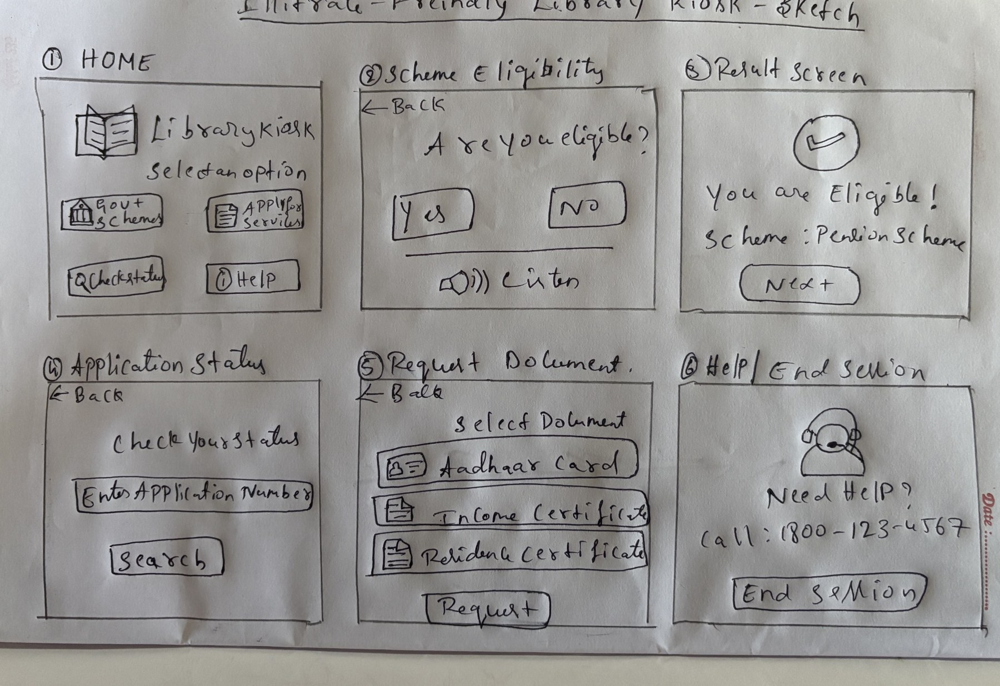
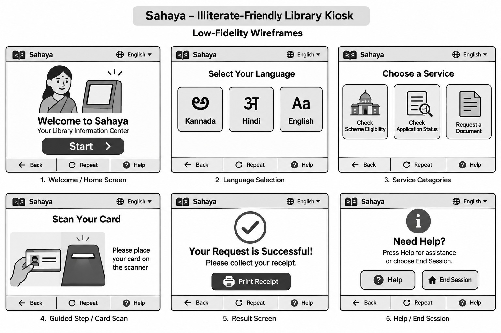
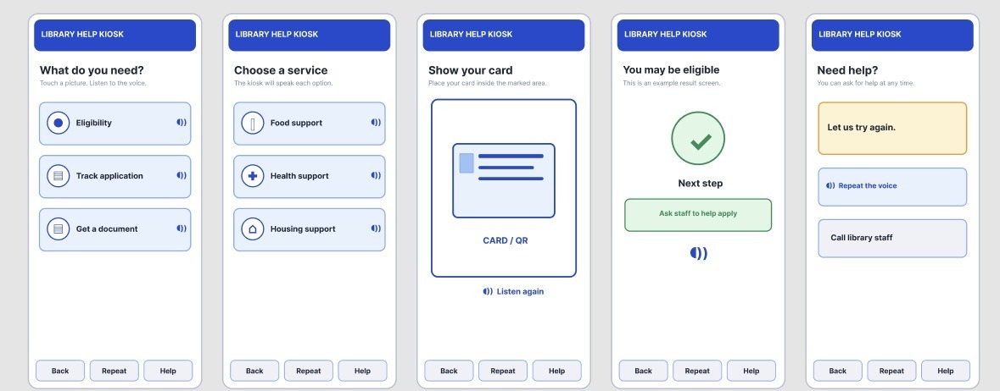

# Illiterate-Friendly Library Kiosk (Sahaya)

**Student:** Madan Naik | **USN:** 1EP25CS407 | **Section:** A
**Course:** Advanced UI/UX, V Semester B.E. | **Problem No.:** 31 | **Domain:** Public Spaces
**Institution:** East Point College of Engineering and Technology, Dept. of CSE

---

## Problem
Design a public digital kiosk that adults who cannot read can use to access government information and services independently, through pictures and spoken guidance instead of written instructions.

## Design summary
- Large picture tiles for three services: check scheme eligibility, check application status, request a document
- Spoken guidance on every screen, with Back, Repeat and Help controls always in the same place
- Language choice (Kannada, Hindi, English), card scan instead of typing, and a privacy reset at the end of each session

## Repository structure
```
UI-UX-LibraryKiosk/
├── README.md
├── app/       Clickable demo of the kiosk (open app/index.html in a browser)
├── figma/     Figma prototype link
├── report/    UI/UX project report (PDF)
└── screens/   Sketches, low-fidelity wireframes and final kiosk screens
```

## Prototype
- Figma prototype: https://www.figma.com/file/70X7D4KcUqt4eWu1vWB6x2?node-id=0:1&type=design
- Clickable demo: `app/index.html` (speaks each option when touched)

## Screens
**Hand-drawn sketches**



**Low-fidelity wireframes**



**Final kiosk screens**



## Report
Full report: [report/1EP25CS407_UI_UX_project_report.pdf](report/1EP25CS407_UI_UX_project_report.pdf)
